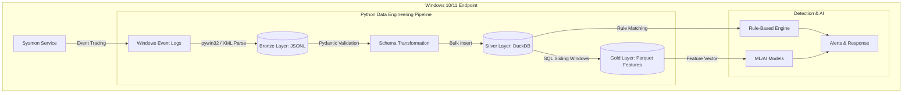

# Phase 1 Data Architecture Mapping (Enterprise to Local)

## 1. Mục đích
Tài liệu này đóng vai trò cầu nối (bridge) giữa Đặc tả Kiến trúc Dữ liệu Tổng thể (`edr_data_requirements_architecture.md`) và Phạm vi Giai đoạn 1 (`phase-1-scope.md`). 
Trong Phase 1, hệ thống vận hành hoàn toàn cục bộ (Local EDR) trên 1 Windows Endpoint, do đó Data Pipeline được down-scale để phù hợp với tài nguyên máy trạm (RAM < 150MB) nhưng vẫn giữ nguyên Schema Pydantic và cấu trúc Medallion.

## 2. Ánh xạ Kiến trúc (Architecture Down-Scaling)

| Thành phần Enterprise (Thiết kế gốc) | Thành phần Phase 1 (Thực tế triển khai) | Lý do điều chỉnh cho Phase 1 |
|---|---|---|
| Ingestion Gateway (Fabric/Kafka) | `pywin32` (`win32evtlog`) + Local Queue | Thu thập trực tiếp từ Windows Event Log / Sysmon cục bộ, không cần network transport. |
| Bronze Layer (OneLake Delta) | Local JSONL (Append-only file) | Lưu trữ sự kiện thô dạng JSONL nhẹ, tốc độ ghi cao trên đĩa cục bộ. |
| Silver Layer (Spark + Delta Table) | DuckDB Embedded (In-memory/Local File) | DuckDB cung cấp năng lực truy vấn OLAP SQL tốc độ cao mà không cần cài đặt server. |
| Gold Layer (Feature Store) | Local Parquet files (`feature_store.parquet`)| Dễ dàng load vào Pandas/Polars để train AI cục bộ. |

## 3. Sơ đồ Luồng Dữ liệu Cục bộ (Local Data Flow)

## 4. Tương thích với Detection Engine của Cyber
Bảng DuckDB ở tầng Silver đóng vai trò là "Local Event Store" trong sơ đồ `preliminary-security-architecture.md`.

* Detection Engine sẽ query trực tiếp vào DuckDB.
* Khóa ngoại `process_guid` được sử dụng để Investigation UI xây dựng Process Tree Visualizer.