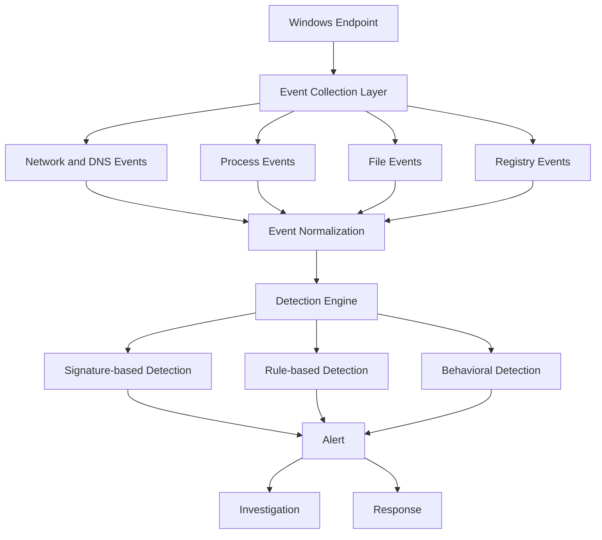

# Preliminary Security Architecture

## 1. Sơ đồ kiến trúc gốc

Luồng trong sơ đồ:

```text
Windows Endpoint
      ↓
Event Collection Layer
      ↓
Process Events / File Events / Registry Events / Network and DNS Events
      ↓
Event Normalization
      ↓
Detection Engine
      ↓
Signature-based / Rule-based / Behavioral Detection
      ↓
Alert
      ↓
Investigation ↔ Response
```

## 2. Biểu diễn bằng Mermaid



## 3. Investigation output trong sơ đồ

- Event Timeline
- Process Tree Visualizer
- Detailed File Information
- Rule Evidence

## 4. Response output trong sơ đồ

- Terminate Malicious Process
- Quarantine File
- Block File Hash
- Update Whitelist

## 5. System Boundary trong Threat Model

```text
┌──────────────── Windows Endpoint ────────────────┐
│ User                                             │
│   ↓                                              │
│ Applications / Processes                         │
│   ↓                                              │
│ Windows OS                                       │
│   ├── Process Events                             │
│   ├── File Events                                │
│   ├── Registry Events                            │
│   └── Network Events                             │
│   ↓                                              │
│ Security Collector                               │
│   ↓                                              │
│ Detection Engine                                 │
│   ├── Signature Database                         │
│   └── Behavior Rules                             │
│   ↓                                              │
│ Alert                                            │
│   ├── Investigation                              │
│   └── Response                                   │
└──────────────────────────────────────────────────┘
```
