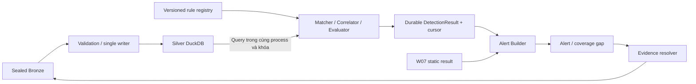
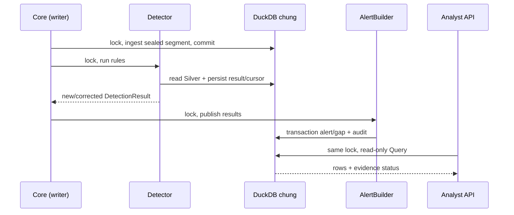

# W06 — Detection Module Architecture v1 (#40)

Ngày: 17/11/2026. **Designed + PoC; chờ Data/Cyber review.** Baseline: `claude_implement` tại `685b3c7`. Trọng tâm tuần theo #40 và PR #36, không thay roadmap đã được nhóm duyệt. Xem [hồ sơ nghiệm thu #40](../../research/software/w7/03-issue-40-handoff-and-review.md).

## 1. Ranh giới module và quyền

| Module / file | Input → output | Lifecycle / lỗi | Owner, quyền |
|---|---|---|---|
| Registry/Loader `src/detection/loader.py` | YAML → rule map đã validate | Load toàn bộ trước activation; YAML/schema/regex/duplicate → `RuleError`, không nạp một phần | Software implementation; Cyber rule logic; đọc config |
| SilverReader `pipeline.query.Query` + engine `_rows` | Filters/cursor → rows Silver | Same-process connection; query tham số hóa; snapshot semantics tại critical section | Data store/schema; chỉ truy vấn Silver |
| Matcher `evaluator.py` | Rule + row → DetectionResult | Required fields thiếu → INSUFFICIENT; điều kiện có sẵn loại trừ → NO_MATCH | Cyber review; không ghi raw |
| Correlator `correlator.py` | Host/path/time groups + watermark → chain result | Late/out-of-order/partial; không bắt creator/executor/deleter cùng GUID | Software + Cyber; bộ nhớ theo phần đuôi và pending chains |
| Process context `process_context.py` | Event + process starts/stops → context/partial | Host+GUID+lifetime; không PID join; missing parent rõ ràng | Helper tham chiếu đã có test; chưa tự động enrich mọi rule |
| Evaluator/Publisher `engine.py` | Rules + rows → `_detection_results` + emitted results | Durable cursor/dedup; partial có thể sửa thành MATCH khi evidence đến muộn | Software; ghi state qua writer duy nhất |
| AlertBuilder `alerts/builder.py` | DetectionResult + rule metadata → alert/gap | MATCH → alert; INSUFFICIENT → gap; PENDING/NO_MATCH không threat alert | Cyber policy, Data persistence |
| EvidenceResolver `alerts/evidence.py` | Event/alert refs → raw/XML hoặc gap | Hash verification, NO_LINEAGE/RAW_EXPIRED/SEGMENT_INVALID | Data lineage, Cyber completeness; đọc Bronze |

Không thay schema Bronze 1.0, event UUIDv5 hay raw preservation. W05 adapter giữ `event_data → raw_data`, `time_created → timestamp`; source clock là SystemTime, giữ EventData.UtcTime riêng.

## 2. Single-writer và read-only interface

**Hiện thực chọn same-process:** CoreService, API và StaticWorkflow dùng một DuckDB connection và cùng `threading.RLock`. Agent chỉ ghi sealed Bronze. Responder không tự mở Silver để ghi. W06 không cấp detector process riêng quyền ghi file DuckDB; constructor engine chỉ được gọi trong writer process.

- Core ingest giữ khóa theo segment; evaluate và alert phases cũng giữ khóa. API chỉ đọc qua Query/HTTP có phân quyền. Static byte I/O ngoài khóa, chỉ đọc provenance và persist result bên trong khóa.
- Thread lock không giải quyết multi-process. Khởi chạy hai core writer là lỗi vận hành; không mô tả DuckDB read-only connection ở process khác như snapshot an toàn khi writer đang mở.
- **Thiết kế nếu tách detector:** writer xuất snapshot bất biến + manifest (`snapshot_id`, schema/mapping version, run_id, event-time bounds, completeness, record counts, sha256); write temp → flush → atomic publish; reader chỉ mở snapshot đã seal. Cursor theo `(snapshot_id,event_time,event_id)`, snapshot missing/hash mismatch/schema major khác phải trả lỗi, không trả batch rỗng giả.
- Snapshot export là **Designed/Future**, chưa tạo dịch vụ read-only mới. API Query cùng process là PoC hiện có đáp ứng lựa chọn read-only API của #40.

## 3. Hợp đồng, lỗi và completeness

[Rule/DetectionResult schemas](contracts/README.md) là snapshot từ `src/detection/schema.py`. Rule version là integer tăng khi đổi điều kiện; namespace `DACN-DET-*` giữ legacy_id riêng. DetectionResult có rule/version, subject, contributing IDs, matched/missing fields, coverage, severity_reason, dedup và notes. Không gán confidence tùy ý.

| Outcome | Nghĩa | Publisher |
|---|---|---|
| MATCH | Đủ điều kiện của rule, không đồng nghĩa confirmed attack | Alert với reason/evidence |
| NO_MATCH | Không khớp điều kiện đã xét; partial chain vẫn có coverage | Không threat alert |
| INSUFFICIENT_TELEMETRY | Không thể đánh giá do thiếu trường | Coverage gap |
| PENDING_LATE_EVENTS | Chờ bước tiếp theo trong cửa sổ | Lưu pending; không threat alert |

Lỗi thực thi loader/DB/I/O không phải NO_MATCH: Core ghi `CORE-001` và last_error/last_ok trên `/health`, giữ checkpoint/retry phù hợp. Proposal error envelope: `{schema_version: dacn-detection-error/1.0, stage, reason_code, run_id, rule_id?, retryable, source_event_ids}`; lỗi infrastructure không đưa vào enum kết quả bảo mật đã có. Bản JSON envelope được bàn giao ở contracts; runtime hiện dùng health/log, chưa có error event bus.

DetectionResult không nhúng raw bytes: EvidenceResolver nối contributing IDs → Silver lineage → Bronze segment/line/hash. Standalone W07 file observation không có source event thì giữ candidate, không tạo GUID/event/raw reference giả. Raw hết hạn không làm thành benign.

## 4. Correlation, lifetime, lateness và replay

- Process context nối `(hostname, process_guid)` và parent GUID, kiểm Event1 trước event, Event5 kết thúc lifetime. Thiếu start/parent → partial, không dựng ancestor từ PID. Helper là bounded reference implementation; Data query/views cũ vẫn cần review host/lifetime riêng.
- DET-010: Event11 tạo → Event1 Image cùng normalized path → 23/26 xóa, theo host và source event-time. Giữ GUID từng actor riêng. `\Device\...` chưa resolve được phải thiếu dữ liệu, không đoán ổ đĩa.
- Watermark hiện là max event-time **từng host**. `allowed_lateness_seconds` tùy chọn, mặc định 0 để giữ rule hiện có, cộng vào mốc đóng cửa sổ. Window 300 s còn `TBD_UNCALIBRATED`; không phải thông số đã benchmark.
- Pending anchors được giữ khi đọc phần đuôi để host khác hoặc batch quá xa không làm mất chain đang mở. NO_MATCH/PARTIAL sau cửa sổ đóng có thể được sửa thành MATCH khi một event có source-time trong cửa sổ đến muộn; dedup key giữ nguyên, một evaluation được cập nhật. Đây là retrospective correction, không engine streaming có guarantee.
- Subject DET-010 là create event ID; evaluation dedup = hash(rule_id,version,subject,window). Alert grouping hiện rule+host+process+600s, 600s chưa hiệu chỉnh. Static sử dụng subject hash của file identity/hash/knowledge/source refs.
- Input đã có đủ → replay không nhân đôi. `ingest_timestamp` cursor vẫn có giới hạn đồng hồ lùi/trùng timestamp giữa các lần ingest. Thay bằng sequence ingestion là Future cần Data contract; không đổi UUID legacy.
- **Publisher đã bổ sung durable outbox:** evaluation/cursor/outbox commit cùng transaction; outbox giữ cả rule metadata/version đóng băng. Core đọc unacked, AlertBuilder + ack trong transaction chung; restart kể cả rule đã gỡ vẫn giao kết quả đúng version. Có test crash trước publish và sau build trước ack. Đây là at-least-once delivery + idempotent alert, không tuyên bố exactly-once distributed streaming. DB cũ trước outbox cần replay có kiểm soát nếu muốn phục hồi lịch sử chưa publish; không suy ra tự backfill mọi alert cũ. W07 submit giữ candidate+alert+audit trong cùng transaction.

## 5. Phân vai review

Software chịu module/API, OS access, lifecycle và tests. Data xác nhận schema/DDL, snapshot/lineage/clock. Cyber xác nhận rule conditions, severity, allowlist precedence và evidence. Chỉ người reviewer thực tế mới ghi sign-off; merge code không thay nghiệm thu. [Feasibility và test plan](../../research/software/w6/03-feasibility-and-test-plan.md).

Nguồn chính thức đối chiếu ngày 17/11/2026: [DuckDB in-process concurrency](https://duckdb.org/docs/2.0/connect/concurrency). Thiết kế này giữ embedded single-writer process của repo; không thêm Quack/client-server hay DuckLake để mở rộng ngoài phạm vi.
