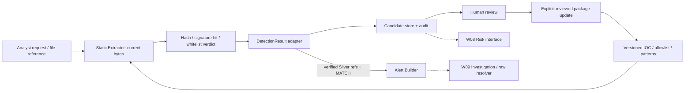
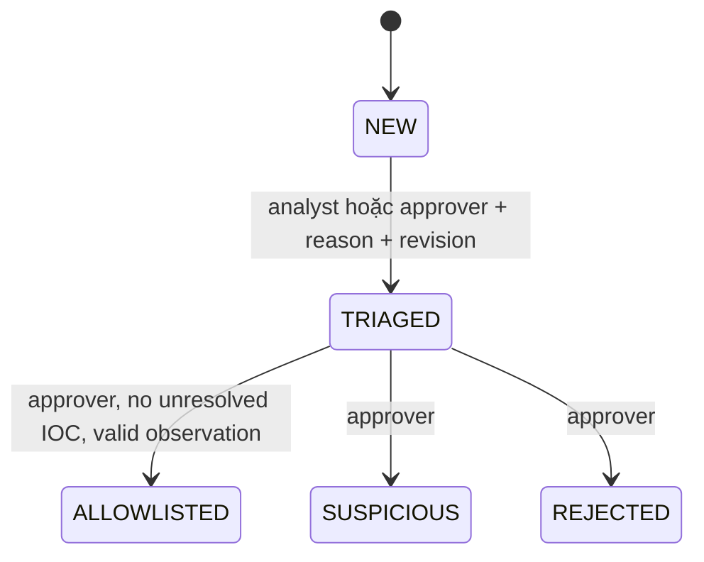
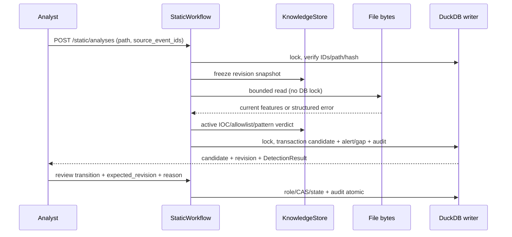

# W07 — Static Extractor, Signature/Whitelist và Candidate Review (#40)

17/11/2026 — **Designed + bounded PoC**, contracts chờ Data/Cyber review. Không nhận đây là antivirus/streaming EDR đã benchmark. [Hồ sơ bàn giao](../../research/software/w7/03-issue-40-handoff-and-review.md).

## 1. Components / interfaces

| Module | Input → output | Lifecycle/errors/quyền |
|---|---|---|
| `StaticExtractor` | Absolute local path, allowed roots, source refs, optional expected hash, literal patterns → StaticResult v1 | Đọc bytes tối đa 16MiB, chunk64KiB, prefix PE64KiB, budget5s; không execute/network |
| `KnowledgeStore` | Validated JSON package → immutable revision snapshot | Schema `dacn-knowledge/1.0`, version integer tăng; hash/expiry/source/reviewer; atomic activate/rollback |
| IOC/Hash matcher | SHA-256 current observation + active indicators → IDs | Expiry kiểm mỗi verdict; missing bytes → UNAVAILABLE, không benign |
| Signature/Pattern Store | Literal byte patterns có ID/source/expiry → hit IDs | 1–256 byte/pattern, tối đa1000, overlap xuyên chunk; không regex/YARA/native plugin |
| Whitelist evaluator | Hash + active exact-hash allowlist → verdict | Static allowlist ưu tiên, giữ IOC/pattern evidence + suppression reason; không xóa behavioral result |
| `StaticWorkflow` | Request + verified Silver source refs → detection/candidate/optional alert | I/O ngoài writer lock; persist candidate+alert+audit trong transaction, không Response Executor |
| `CandidateStore` | Analysis/verdict + reviewer transition → state/revision/audit | CAS revision, role check, reason bắt buộc; không tự promote global allowlist |

Pattern hits không khẳng định malicious; signature byte pattern khác digital signature. PE parser hiện đọc COFF metadata tối thiểu, không full imports/disassembly. Digital signature luôn `UNAVAILABLE / NO_OFFLINE_TRUST_PROVIDER` trong PoC; không gọi PowerShell/WinVerifyTrust có thể truy cập mạng. Thiết kế provider mở rộng bên dưới.

## 2. File access semantics

Sysmon ID11/26 là telemetry, không cung cấp bản sao bytes lịch sử. Extractor ghi `observed_at`, path, dev/inode/size/mtime identity, extractor version và `historical_identity`. Nếu source Silver có hash thì phải khớp mới `HASH_VERIFIED`; không có hash → `UNVERIFIED`, coverage CURRENT_BYTES_ONLY. SHA-256 không chứng minh malware.

- Absolute path bên trong root được server cấu hình; API mặc định `<EDR_HOME>/lab`. Không nhận root từ request. Reject UNC/device/ADS, symlink/reparse trên các thành phần, directory/nonregular và outside roots. Bảo vệ đường dẫn hệ thống bằng root whitelist đọc file; Response policy cũ vẫn là authority riêng cho protected processes/paths.
- Đọc một handle, so identity path→handle và trước/sau; giới hạn bytes/time; kiểm lại path sau đọc. Thay đổi → FILE_CHANGED và bỏ mọi partial hash/features. Python Windows stat/fstat `st_ctime` có khác nghĩa nên không dùng nó làm equality trên Windows; POSIX có dùng ctime.
- Error codes: INVALID_PATH, OUTSIDE_ROOTS, REPARSE_POINT, NOT_REGULAR_FILE, NOT_FOUND, TOO_LARGE, TIMEOUT, ACCESS_DENIED_OR_LOCKED, FILE_CHANGED, HASH_MISMATCH, IO_ERROR. Không retry vô hạn, không default hash rỗng hay signature unsigned.
- `signature.status` khác `pattern_ids`. Provider tương lai phải nhận cùng file identity/hash, chạy offline với quyền chỉ đọc và có timeout; trả VERIFIED_TRUSTED / VERIFIED_UNTRUSTED / UNSIGNED / ERROR / UNAVAILABLE, provider/version/time và trust policy. Không map lỗi thiếu quyền/thư viện thành UNSIGNED. Schema major/minor cần Data/Cyber review trước khi mở rộng enum hiện tại.

TOCTOU residual: metadata check user-space không chống attacker admin thay bytes rồi khôi phục metadata, không có snapshot filesystem/handle pin đối với mọi ancestor. Cần NTFS ACL, root do operator kiểm soát; không gọi đây là forensic historical image. [Windows Safety Notes](../../research/software/w7/01-windows-file-access-and-safety.md).

## 3. Contract và data model

[JSON schemas/examples](contracts/README.md): static-result, whitelist-verdict, signature-hit, candidate, knowledge package. `src/static_analysis/contracts.py` là source. Chỉ thêm `static_candidates` table; giữ Silver/Gold v1.1 và Bronze 1.0 nguyên trạng. DDL extension cần Data sign-off trước production, tương tự v1.2 proposal đã dùng trên nhánh nền.

- StaticResult giữ feature statuses, source_event_ids và observation identity. Không lưu file bytes vào DB/log/API.
- Knowledge revision = SHA-256 canonical JSON. Schema version nói format, version integer nói nội dung, revision nói đúng bytes canonical. Ba ý nghĩa không thay thế nhau.
- Detection adapter dùng proposed namespace `DACN-STATIC-001` version1 để không tự chiếm DET-005/006/009 của Cyber. Cần Cyber review tên/logic. MATCH chỉ IOC/pattern active; allowlist → NO_MATCH của nhánh static, không sửa kết quả behavioral.
- Source IDs phải tồn tại trong Silver và path đúng file của event. Source hashes mâu thuẫn hoặc path không khớp → reject input. Source hash khác current bytes → observation ERROR/INSUFFICIENT, không tạo full static hit.
- Không có source event: vẫn có standalone candidate/hits nhưng không tạo alert/event ID/raw reference giả. Có refs thì AlertBuilder sử dụng source IDs để resolver trả raw hoặc NO_LINEAGE/RAW_EXPIRED.

## 4. Candidate lifecycle / authorization

Mọi update expected_revision cũ →409, role sai →403, ID không tồn tại →404, reason trống →422/validation. State và audit hash-chain cùng transaction. `SUSPICIOUS` không là confirmed attack. `ALLOWLISTED` là kết luận review **cho observation này**, không âm thầm sửa kho global; operator phải activate package allowlist đã review hoặc dùng luồng ADD_WHITELIST được duyệt riêng. Điều này tách review evidence với quyền thay policy.

Knowledge activation/rollback chỉ approver. Viewer đọc candidate/history; analyst submit/triage; responder không đọc hoặc sửa workflow static. Audit identity lấy từ token, không actor trong request body. Review không được tự terminate/quarantine.

## 5. Update, expiry, cache và rollback

1. `activate(bundle, expected_revision, actor, reason)` validate full package: schema major, monotonic version, IDs, hashes, source, timezone expiry, literal length/count và size. Không nhận URL/feed.
2. Ghi revision canonical JSON bằng temp/fsync/replace; pointer current/history chỉ đổi sau revision bền. Publish lỗi → revision cũ còn nguyên. Existing snapshot giữ nguyên cho analysis đang chạy.
3. `rollback(revision, expected_revision, actor, reason)` chỉ revision đã activate, revalidate schema/hash; audit history lưu previous/current. Không rollback silently khi config hỏng; lỗi hiển thị cho operator.
4. Expiry kiểm lúc evaluate, kể cả snapshot lấy trước đó. Cache không bỏ quét file chỉ theo path/mtime. PoC không cache bytes/matches; rescan bounded để tránh stale. Cache tương lai phải keyed SHA/identity/extractor+knowledge revision và TTL≤expiry sớm nhất.
5. SHA manifest phát hiện corruption, **không phải signed trust**. NTFS ACL bảo vệ knowledge root; signed updates/multi-process file locks là Future. Chỉ một writer process cho review+knowledge; API shared lock serialize activate/review.

## 6. Integration sequence, W08/W09

W08 Risk Aggregator nhận IDs/version/reasons/coverage/source refs/optional feature values; chưa có numeric confidence hoặc risk calibration. W09 Investigation lấy candidate/history, alert IDs, current observation và Silver→Bronze evidence; phân biệt current bytes, historical hash và missing raw. Không thêm ML runtime hoặc UI mới làm điều kiện #40.
